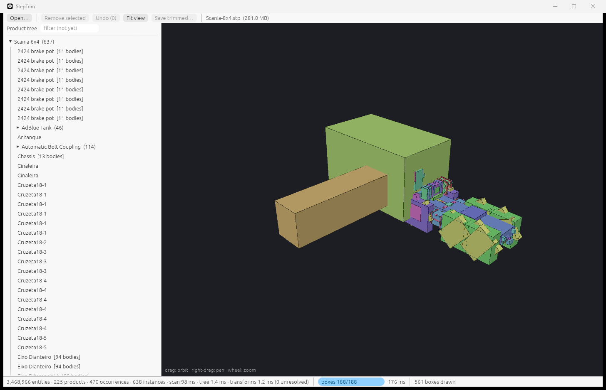
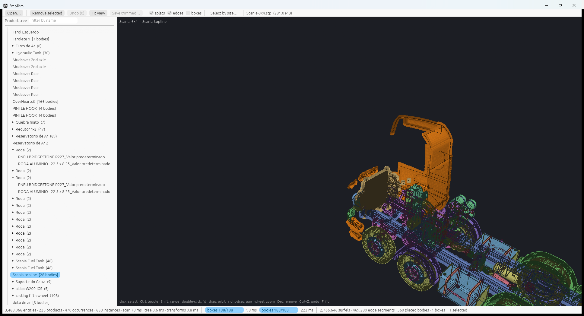
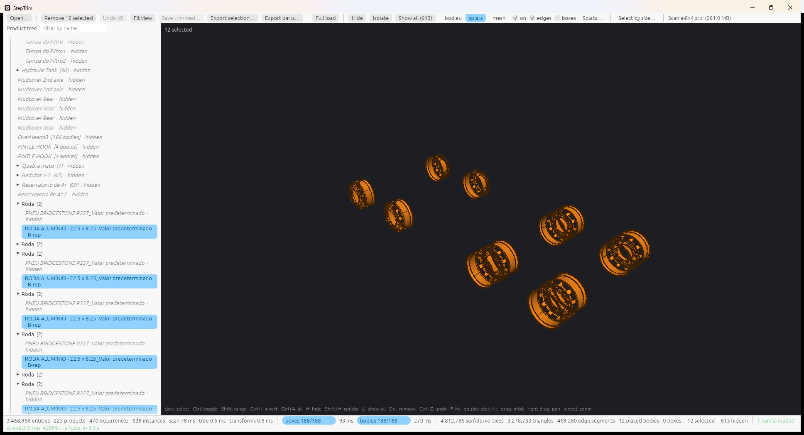
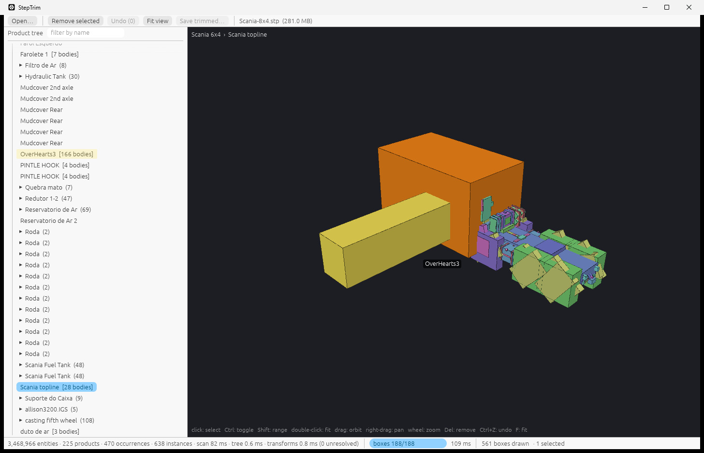
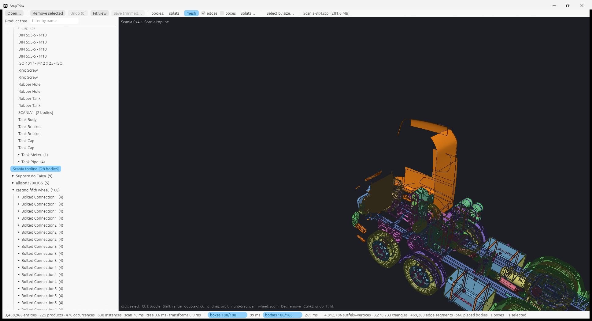
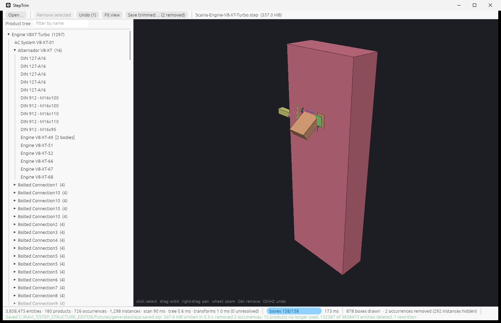

# StepTrim

StepTrim opens very large STEP assemblies in well under a second, shows them at reduced
fidelity without a CAD kernel, lets you delete the parts you do not need, and saves a STEP file
that still opens in any CAD system. When you want to see a part exactly, it borrows FreeCAD's
Open CASCADE kernel for just that part.



Design document: [docs/StepTrim_Design.md](docs/StepTrim_Design.md)
(live copy: <https://claude.ai/code/artifact/16b44a95-789d-42d4-ae2f-6b6396d58d9d>).
Repository: <https://github.com/santa326/steptrim>.

## Download

Windows 10 or 11, 64-bit, with a GPU driver that supports Vulkan or DirectX 12. Get the latest
build from <https://github.com/santa326/steptrim/releases/latest>:

- **StepTrim-Setup-\<version\>.exe**: the installer. It installs for the current user by
  default, so there is no administrator prompt, and adds a Start Menu entry, an optional desktop
  shortcut, "Open with" entries for `.stp` and `.step` files, and an uninstaller under
  Settings → Apps. The command-line tools are installed beside the app.
- **StepTrim-\<version\>-windows-x64.zip**: the portable build. Unzip anywhere and run
  `steptrim.exe`; nothing is written outside that folder.

Both are built by GitHub Actions from the tagged source, and `SHA256SUMS.txt` on the release
page lists their checksums. FreeCAD 1.0 is optional and only needed for Full load.

**Code signing policy.** Releases are signed through SignPath Foundation; see
[CODE_SIGNING_POLICY.md](CODE_SIGNING_POLICY.md). Free code signing provided by
[SignPath.io](https://about.signpath.io), certificate by
[SignPath Foundation](https://signpath.org). Releases published before signing was in place
(0.1.0) are unsigned, and Windows SmartScreen shows "Windows protected your PC" the first time
they run: click "More info", then "Run anyway". A signed build can still show that screen while
the certificate builds reputation with Microsoft; it goes away as downloads accumulate.

## What it solves

A supplier sends a 1 GB STEP file of a whole machine when you need one sub-assembly. Opening it
in a CAD system takes minutes and gigabytes of memory, because the importer rebuilds every curve,
surface and solid before it shows anything. Then you delete the parts you do not want and
re-export, and the exporter rewrites all the surviving geometry with its own tolerances, so the
file you pass on is no longer the file you received.

StepTrim takes the other route. A STEP file is text: a product tree and the geometry under it,
all cross-referenced by entity number. StepTrim reads that text directly, shows the tree in
milliseconds and a rough picture of every part within a second, and removes parts by editing the
text. Every entity that survives is copied byte for byte. The result is a smaller STEP file that
opens quickly in CAD and whose geometry is identical to the source.

Typical uses:

- Cut a plant or vehicle model down to the area you are working on before opening it in CAD.
- Strip fasteners and small hardware from a model by size, then save.
- Pull a few parts out of a large assembly into their own STEP files.
- Inspect what a STEP file contains, and how it is structured, without a CAD seat.

## How it solves it

Everything runs from one parallel scan of the file's text; no CAD kernel sits between the input
file and the saved file.

1. **Scan.** Workers take 4 MB byte ranges and find every entity's byte span, id and type name
   using SIMD byte search. Attributes are parsed later and only for the entities a step asks
   about. The scan runs at 4 GB/s on a laptop, so a 1 GB file is indexed in a quarter of a
   second.
2. **Product tree.** The PRODUCT, PRODUCT_DEFINITION and NEXT_ASSEMBLY_USAGE_OCCURRENCE entities
   become a tree of parts and sub-assemblies with their placements. The tree appears on screen
   as soon as the scan finishes, before any geometry is touched.
3. **Boxes.** For every part, a walk over its geometry collects vertex points, spline control
   points and arc extents into a bounding box. Boxes stream into the viewport while the walk
   runs.
4. **Bodies.** Faces are sampled in the parameter space of their own surface and trimmed by an
   even-odd test against the face loops. Each sample becomes an oriented disc, drawn opaque
   with a depth test, so millions of them need no sorting. The same pass triangulates planar
   faces exactly and lays grids over curved ones for the mesh mode. Edges are evaluated exactly
   from the file.
5. **Remove.** Deleting an occurrence deletes its NEXT_ASSEMBLY_USAGE_OCCURRENCE and lets the
   consequences propagate through a reference graph: entities that referenced it through a
   single attribute are deleted, entities that listed it in an aggregate are rewritten without
   it, and entities that have lost all their owners are garbage-collected. Styles, layers,
   categories, properties, documents and approvals count as decoration, not owners. A part that
   has lost its last occurrence goes with its geometry.
6. **Save.** The writer streams every surviving entity's original bytes to the output and only
   re-serialises the handful of aggregates that lost an element. The header and entity numbers
   are untouched. The output is re-scanned to confirm that every reference resolves.

The viewer is wgpu with egui: one instance buffer for all placements, instanced boxes, and
per-part surfel, line and triangle ranges that upload incrementally as the loader produces them.



## Where FreeCAD fits

StepTrim has no CAD kernel of its own, on purpose: the kernel is what makes CAD slow. Two
things still need one, and for both StepTrim uses an installed FreeCAD 1.0, which ships Open
CASCADE and a scriptable command-line host (FreeCADCmd.exe).

**Full load.** The sampled preview is approximate: curved faces are discs or grids, and
freeform faces are drawn untrimmed. When you need a part exactly, select it and press Full
load. StepTrim exports each selected part as a standalone STEP file through the same pruner as
Save, starts one FreeCADCmd process with a small script, and that script imports each file and
meshes it with Open CASCADE at a deflection scaled to the part's size. Each finished mesh
streams back into the viewer as the next part is still meshing, in the part's own frame, so
every placed instance of that part shows the exact shape at once. Parts loaded this way are
marked "B-rep" in the tree and draw as triangles in both body modes. Files in inches come back
from the kernel in millimetres and are rescaled to the file's units.

**Cross-checking.** During development, `tools/freecad_tree.py` dumps the tree FreeCAD builds
from a file so StepTrim's tree and its trimmed outputs can be compared against an independent
reader.

FreeCAD is never on the path from the input file to the saved file. Saving does not need it,
and the app runs without it; only the Full load button is disabled when it is not found.
StepTrim looks for it under Program Files, then in `STEPTRIM_FREECAD`, then on the PATH. It
is invoked as a separate process, not linked.



## Install and build

Requires Rust stable with the MSVC toolchain on Windows. FreeCAD 1.0 is optional and only
needed for Full load.

```powershell
cargo build --release
cargo test --release
.\target\release\steptrim.exe fixtures\steptools\Scania-8x4.stp
```

The public sample assemblies used throughout this README come from STEP Tools, Inc. and are
downloaded by `tools/download_fixtures.sh`; they are not in the repository.

To cut a release, bump `version` in the workspace `Cargo.toml`, commit, and push a matching tag:

```powershell
git tag v0.1.0
git push origin v0.1.0
```

The release workflow (`.github/workflows/release.yml`) runs the tests, builds the four
executables, submits them to SignPath for signing, zips the signed files, compiles the installer
from `installer/steptrim.iss` with Inno Setup, submits the installer for signing, and attaches
everything with checksums to a GitHub release. Each signing request waits for a team member's
approval in SignPath, for up to two hours. The same workflow can be run by hand from the
Actions tab, either to publish a release for the version in `Cargo.toml` or just to get the
files as a workflow artifact. The artifact configurations SignPath uses are kept in
`signing/`.

## Tutorial

### 1. Open a file

Use **Open…** in the toolbar, pass the path on the command line, or drop the file on the
window. The status bar shows the scan time and entity counts, then two progress bars: boxes
and bodies. The product tree is usable immediately; boxes replace themselves with bodies as
sampling finishes. Opening another file cancels the current load.

### 2. Read the tree and the viewport

The left panel is the product tree. Assemblies show their instance count; parts with several
solids show their body count. The filter box above the tree lists every instance whose part
name contains the text.

In the viewport, left-drag orbits, right-drag pans, the wheel zooms, and double-click fits the
view to the box under the pointer. Hovering a part tints it yellow in both the tree and the
viewport and names it next to the cursor; the header line above the viewport shows the full
assembly path of the hovered or selected part.



### 3. Select

Selection is shared between the tree and the viewport.

| Action | Effect |
| --- | --- |
| Click a row or a part | Select it alone |
| Ctrl+click | Toggle it in the selection |
| Shift+click | Select the range from the last click, in the tree's row order |
| Ctrl+A | Select every visible part |
| Ctrl+I | Invert the selection among visible parts |
| Click a part in the viewport | Also expands and scrolls the tree to it |

Selecting an assembly selects its whole subtree, drawn in a lighter orange.

**Select by size…** opens a panel that selects visible parts by their box diagonal in file
units. Set a from/to range or use the quick presets (parts smaller than 1, 2, 5 or 10 percent
of the largest part), watch the live match count, then press **Select**, **Add to selection**
or **Remove them**. This is the fast way to strip fasteners.

### 4. Look closer

The toolbar's **bodies:** choice switches between **splats** (oriented discs) and **mesh**
(triangles). **on** toggles the bodies, **edges** toggles the exact edge lines, and **boxes**
draws every part's box as well; boxes are always drawn for parts whose bodies are not sampled
yet.



**Splats…** opens the sampling panel:

| Control | What it does |
| --- | --- |
| Disc size | Multiplier on the disc radius, applied live in the shader |
| Samples across a part | Sampling density, default 56; applied by Resample |
| Max surfels per part | Cap per part; applied by Resample |
| GPU budget | Cap on surfels plus mesh vertices; parts that would overflow it stay as boxes |
| Resample | Re-runs the sampler in the background while boxes stand in |
| Exact B-rep meshes | Count of parts loaded through Full load, with **Clear** to drop them |
| Kernel host | The FreeCADCmd path StepTrim found, or a note that it is missing |

**Full load** (toolbar, or right-click → Full load) replaces the sampled bodies of the
selected parts with exact meshes from Open CASCADE. The button shows a spinner and the number
of parts still pending; the status bar reports the triangle count and time when done. Loading
several parts in one selection is cheaper than one at a time, because each run pays FreeCAD's
start-up once.

### 5. Hide and isolate

Visibility is separate from removal: hidden parts are still saved.

| Action | Keys | Effect |
| --- | --- | --- |
| Hide | H | Hide the selected parts |
| Isolate | Shift+H | Hide everything except the selection |
| Show all | U | Show every hidden part |
| Show | context menu | Show the selected hidden parts |

Hidden parts are dimmed and marked "hidden" in the tree.

### 6. Remove and undo

**Remove selected** (or Delete) removes the selected occurrences; the subtree disappears from
the viewport and the row is struck through in the tree. Right-click a row for more options:
**Remove** this occurrence, **Remove all N occurrences of this part**, and **Restore**.
**Undo** (Ctrl+Z) reverses removals one step at a time.



### 7. Save and export

| Button | Output |
| --- | --- |
| Save trimmed… | The whole file without the removed occurrences, default name `<file>-trimmed.stp` |
| Export selection… | One STEP file containing only the selected parts, with the assembly structure down to them kept |
| Export parts… | One standalone STEP file per selected part into a folder, each part becoming the root of its file |

All three go through the same pruner: surviving geometry is copied byte for byte and the
output is checked for dangling references. The status bar shows the size, time and entity
counts when the write finishes.

### 8. Reference: toolbar

Open… · Remove selected · Undo · Fit view (F) · Save trimmed… · Export selection… · Export
parts… · Full load · Hide · Isolate · Show all · bodies: splats | mesh · on · edges · boxes ·
Splats… · Select by size… · file name and size.

### 9. Reference: right-click menu on a tree row

Restore · Remove (or Remove N selected) · Remove all N occurrences of this part · Fit view to
this (or to selection) · Show / Hide · Isolate · Show all · Full load (exact B-rep) · Export
selection as one STEP… · Export each selected part as a STEP…

### 10. Reference: keyboard

| Key | Action |
| --- | --- |
| Delete | Remove the selection |
| Ctrl+Z | Undo the last removal |
| F | Fit the view to the selection, or to everything |
| Ctrl+A | Select all visible parts |
| Ctrl+I | Invert the selection |
| H | Hide the selection |
| Shift+H | Isolate the selection |
| U | Show all |

### 11. Reference: command-line flags for the app

The app can be driven without clicks, which is how its tests and screenshots are made. Name
matches are case-insensitive substrings of the part name; the repeatable flags can be given
more than once.

| Flag | Effect |
| --- | --- |
| `FILE` | Open this file |
| `--remove NAME` | Remove every occurrence of parts whose name contains NAME (repeatable) |
| `--select NAME` | Select every instance whose part name contains NAME (repeatable) |
| `--hide NAME` | Hide every instance whose part name contains NAME (repeatable) |
| `--isolate` | Hide everything except the selection |
| `--fit` | Fit the view to the selection |
| `--mode mesh` or `--mode splats` | Start in that body mode |
| `--samples N` | Resample at N samples across a part after loading |
| `--full-load` | Run Full load on the selection |
| `--export-one FILE` | Export the selection as one STEP file |
| `--export-dir DIR` | Export each selected part as a standalone STEP file into DIR |
| `--save FILE` | Save the trimmed file after the removals |

Environment: `STEPTRIM_FREECAD` points at FreeCADCmd.exe when it is not under Program Files;
`RUST_LOG=info` prints load and full-load progress to stderr.

Example:

```powershell
.\target\release\steptrim.exe model.stp --remove "Cylinder Head" --save trimmed.stp
.\target\release\steptrim.exe model.stp --select Roda --full-load --isolate --fit
```

### 12. Reference: command-line tools

`stepinfo` scans a file and prints its structure and timings:

| Flag | Effect |
| --- | --- |
| `--tree-depth N` | Depth of the printed tree, default 3 (0 for none) |
| `--expand` | One line per occurrence instead of grouping identical siblings |
| `--top-types N` | Entity types to list in the histogram, default 12 |
| `--chunk-mb N` | Scan chunk size, default 4 |
| `--threads N` | Worker threads, default all cores |
| `--json FILE`, `--json-depth N` | Write the expanded tree as JSON |
| `--bounds` | Also compute transforms, instances and per-part boxes |
| `--check-refs` | Check that every reference resolves |
| `--geometry` | Also sample body geometry for every part and report totals |

`stepprune` removes occurrences from the command line and re-scans its output:

| Flag | Effect |
| --- | --- |
| `--remove-name TEXT` | Remove every occurrence whose child part name contains TEXT (repeatable) |
| `--remove-occurrence ID` | Remove the occurrence with this entity id (repeatable) |
| `--remove-under "PARENT::CHILD"` | Remove matching children under a given parent |
| `--out FILE` | Output file, default `<file>-trimmed.stp` |
| `--dry-run` | Plan and report only |
| `--check` | Re-scan the output (on by default) |
| `--explain` | For orphaned parts whose geometry survives, list what still references it |

`stepreplicate` builds large test files by placing K renumbered copies of a file under a new
root: `--copies K` (default 3), `--cols N` (default 4), `--spacing D`, `--out FILE`.

```powershell
.\target\release\stepinfo.exe fixtures\steptools\as1-ec-214.stp --tree-depth 4
.\target\release\stepprune.exe fixtures\steptools\Scania-8x4.stp --remove-name "Roda" --out trimmed.stp
.\target\release\stepreplicate.exe fixtures\steptools\Scania-Engine-V8-XT-Turbo.step --copies 3 --cols 2 --out fixtures\generated\scania-engine-x3.stp
```

## Limitations

Preview fidelity:

- Surfaces of revolution, surfaces of linear extrusion and offset surfaces are drawn as their
  edge loops only. B-spline faces are drawn as the whole untrimmed patch, because the p-curves
  that trim them are not evaluated, so holes in freeform faces are missing.
- Boxes of spline-heavy parts over-estimate, since control points bound the surface loosely.
- Curves drawn: lines, circles, ellipses, B-splines, polylines, trimmed and surface curves.
  Hyperbolas, parabolas and composite curves are not drawn.
- Colours and layers in the file are ignored; parts are coloured by a hash of their definition
  so neighbours differ. Annotations and PMI are not shown.
- AP242 files that carry tessellated faces are not yet drawn from those triangles.
- Sampling density is uniform per part, not adaptive to the screen, and dense resamples are
  limited by the GPU budget.

Full load:

- Needs FreeCAD 1.0 installed, and the lookup is Windows-only for now. Each request pays about
  4 s of FreeCAD start-up, then one to seven seconds per part. A run cannot be cancelled.
- Exact meshes live in memory for the session; they are not cached on disk.
- Unit detection compares bounding boxes against known factors (inch, foot, metre, centimetre).
  A file in an unusual unit would be drawn at the kernel's scale.
- A definition that carries both its own bodies and child parts is meshed together with its
  children, so those children show twice.

Editing and saving:

- Removal works on occurrences. A single body inside a multi-body part cannot be removed, and
  geometry cannot be edited.
- Validation properties of parents that lost a child are deleted, not recomputed.
- The header is kept as it was: file name, timestamp and author are not updated. Entity numbers
  are kept, so the output has gaps in its numbering, which is valid.
- The ownership rules that decide what goes with a removed part are token-based and were
  validated on the twelve fixtures (exports from Inventor, SolidWorks, Pro/ENGINEER, CATIA V4,
  CADDS, CAS.CADE, ASCON and ST-Developer). An unfamiliar exporter could keep or drop an
  annotation unexpectedly.
  The reference check catches dangling references, not semantic omissions.
- Trimmed files have been verified in FreeCAD only. Imports into NX, Creo, SolidWorks and CATIA
  have not been tested.

Format and platform:

- Part 21 text only. Compressed `.stpz`, zipped STEP and Part 28 XML are not read. Edition 3
  ANCHOR, REFERENCE and SIGNATURE sections are not handled.
- A multi-line `/* */` comment containing text that looks like an entity start would confuse
  the chunk boundaries.
- The file is memory-mapped whole, so a 64-bit build is required. The timings below assume the
  file is in the page cache; a first open from a cold disk is bound by disk speed.
- No settings persistence or recent-files list; no undo after a save.
- Built and tested on Windows only. The crates are cross-platform but Linux and macOS builds
  have not been tried.

## Measured on this machine (i9-14900HX, 32 threads, RTX 4070 Laptop, file in page cache)

| File | Size | Entities | Scan | Rate |
| --- | --- | --- | --- | --- |
| Scania engine (Inventor) | 357 MB | 3.86 M | 77 ms | 4.6 GB/s |
| Scania engine, 1 thread | 357 MB | 3.86 M | 318 ms | 1.1 GB/s |
| Engine x3 (generated) | 1,068 MB | 11.6 M | 248 ms | 4.3 GB/s |
| Engine x6 (generated) | 2,158 MB | 23.2 M | 507 ms | 4.2 GB/s |

Body sampling (`stepinfo --geometry`), in parallel over parts at about 56 samples across each:

| File | Faces | Edge segments | Surfels | Time |
| --- | --- | --- | --- | --- |
| Scania truck, 281 MB | 26,736 | 469k | 2.77 M, plus 3.28 M triangles | 234 ms |
| Scania engine, 357 MB | 27,724 | 617k | 3.46 M | 740 ms |
| Nissan GT-R, 167 MB | 25,966 | 699k | 1.98 M | 232 ms |

Full load through FreeCAD (one process per request, start-up included):

| Parts | Triangles | Time |
| --- | --- | --- |
| Truck tyre and rim (12 wheels placed) | 65,946 | 14.5 s |
| Truck rim alone | 42,896 | 8.0 s |
| Rear axle tyre and rim (inch file, rescaled) | 33,764 | 1.1 s |

Product-tree extraction after the scan takes under 3 ms on all of these. Pruning the truck
(air tank and twelve wheels, 85 occurrences) plans in 73 ms and writes 279 MB in 125 ms;
removing both cylinder heads from the engine deletes 132k entities and writes 348 MB in 0.3 s.
Occurrence transforms resolve for every occurrence in all twelve fixtures. The per-part box walk
takes 250 ms for the 357 MB engine and 180 ms for the 281 MB truck.

## Fixture cross-check

`tools/freecad_tree.py` dumps the tree FreeCAD 1.0 builds from a file. Counting FreeCAD's
`App::Part` and `Part::Feature` objects against `stepinfo`'s expanded instances:

| File | FreeCAD | stepinfo |
| --- | --- | --- |
| as1-ec-214.stp | 28 | 28 |
| rear.stp | 50 | 50 |
| UMC-500 (SolidWorks) | 456 | 351 instances, 336 bodies |
| as1 trimmed (rod assembly removed) | 24 | 24 |
| Scania 8x4 trimmed (air tank, wheels removed) | 1462, from 1569 | 531, from 638 |

FreeCAD splits a multi-body part into an `App::Part` container with one `Part::Feature` per
body. Predicting its counts from our bodies-per-part (110 containers, 336 features) lands
within 5 of FreeCAD's 115 and 341; the residual is not yet explained.

## Repository layout

| Path | What |
| --- | --- |
| `crates/steptrim-core` | Library: parallel Part 21 scanner, entity table, attribute parser, header parser, product tree, placements and boxes, body sampler, pruner and verbatim writer |
| `crates/steptrim-cli` | `stepinfo`, `stepprune` and `stepreplicate` |
| `crates/steptrim-app` | `steptrim`, the desktop app: egui + wgpu viewer, progressive load, selection, visibility, removal, save and export, Full load through FreeCAD |
| `fixtures/steptools` | Public sample assemblies from steptools.com (downloaded by `tools/download_fixtures.sh`, not in git) |
| `fixtures/generated` | Files over 1 GB made with `stepreplicate` (not in git) |
| `fixtures/freecad` | FreeCAD tree dumps for cross-checking |
| `docs/` | Design document, diagrams and screenshots |
| `tools/` | Fixture download script and the FreeCAD tree dump script |
| `installer/` | Inno Setup script for the Windows installer |
| `signing/` | SignPath artifact configurations for the executables and the installer |
| `.github/workflows/` | CI (tests on every push) and the release build |

## Credits

- **Ravi Teja Potineni** set the goal, chose the product direction and tested every feature.
- The design document and the code were written with **Claude Code** (Anthropic's Claude
  Fable 5.1) under that direction.
- **FreeCAD** (LGPL-2.1-or-later) and **Open CASCADE Technology** (LGPL-2.1 with exception)
  provide the exact tessellation behind Full load and the independent reader used for
  cross-checks. StepTrim runs FreeCADCmd as a separate process and does not link to either.
- **STEP Tools, Inc.** publishes the sample assemblies used for development and in the
  screenshots: the Scania engine and truck, the Nissan GT-R, the UMC-500, as1 and rear.
- Rust crates: eframe and egui (MIT or Apache-2.0), wgpu (MIT or Apache-2.0), rayon, memchr,
  memmap2, glam, bytemuck, rfd, earcut (ISC, a port of Mapbox's earcut), clap, serde and
  serde_json, anyhow, log and env_logger, itoa.
- Standards and references: ISO 10303-21 and the AP203, AP214 and AP242 application protocols;
  the CAx-IF recommended practices for validation properties; the Open CASCADE STEP and mesh
  user guides.

## Licence

StepTrim is released under the MIT License; see [LICENSE](LICENSE). FreeCAD and Open CASCADE
are separate programs under their own licences and are not distributed with StepTrim.
