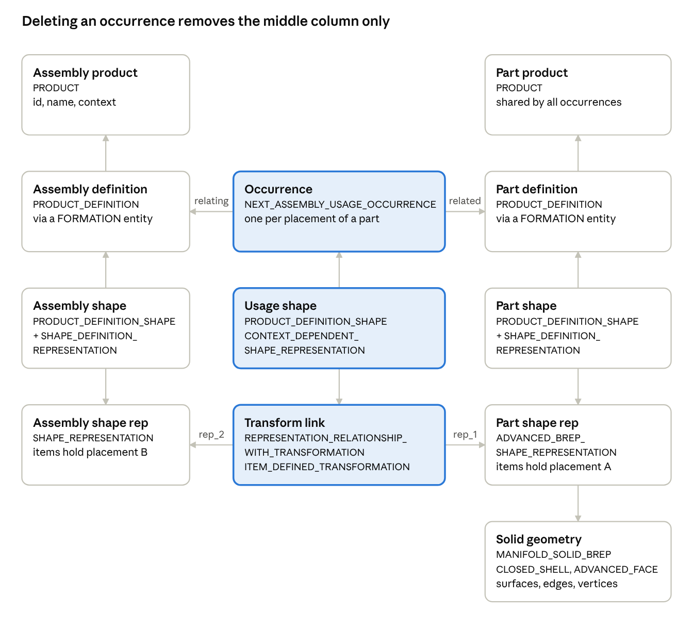
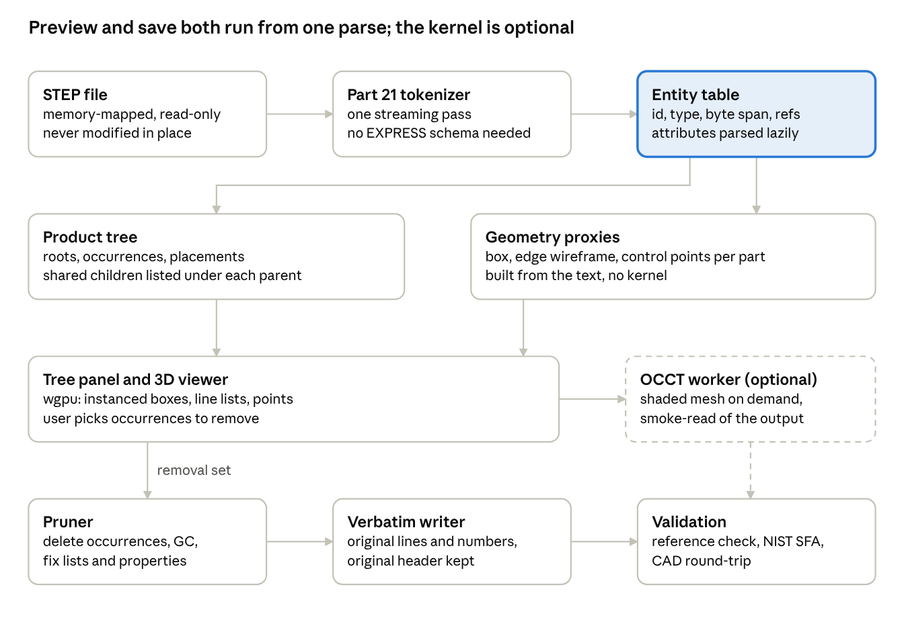
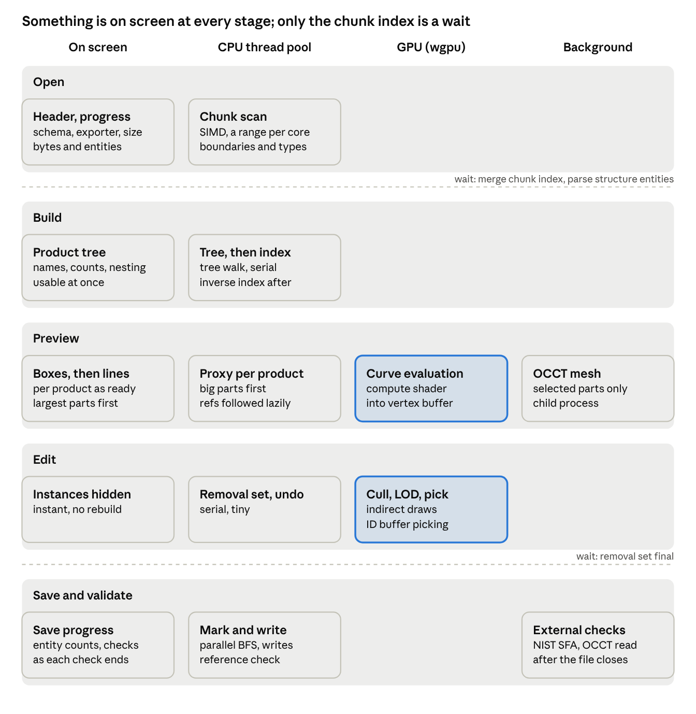

# StepTrim Design

Local export of https://claude.ai/code/artifact/16b44a95-789d-42d4-ae2f-6b6396d58d9d (the live, editable copy). Diagrams are in diagrams/.

Oct 19, 2026 · @Ravi

## Problem and goals

Large STEP assemblies are slow or impossible to open in CAD. The fix is to strip parts the user does not need before the CAD system ever sees the file. That needs a tool that opens the STEP file fast, shows enough of it to recognise parts, lets the user delete occurrences from the product tree, and writes a STEP file that still opens cleanly in SolidWorks, NX, CATIA, Creo, Fusion and FreeCAD.

The preview is the hard part. Exact B-rep tessellation through a CAD kernel is what makes CAD slow in the first place, so the preview must not depend on it. The user asked whether voxels or other non-solid representations can stand in; this doc answers that in the preview section.

**Goals**

1. Open a multi-hundred-megabyte STEP assembly and show the product tree within seconds.
2. Keep the window responsive during load: the tree and boxes appear while the file is still being processed.
3. Show a rough 3D preview, good enough to tell a bracket from a housing, without full B-rep tessellation.
4. Let the user select and remove parts or whole sub-assemblies from the tree, and see the preview update.
5. Save a valid ISO 10303-21 file that keeps the surviving geometry byte-for-byte identical to the source.
6. Keep names, colours, layers and placement of surviving parts.

**Non-goals**

- Editing geometry, moving parts, or changing placements.
- Exact rendering, measurement, or PMI display.
- Converting between application protocols (AP203, AP214, AP242).

**Success check.** The saved file opens in at least two of the target CAD systems with the removed parts absent and every other part unchanged, and the preview appears before a CAD kernel could have finished reading the same file.

## STEP format primer

A STEP file is plain text: a HEADER, then a DATA section of numbered entity instances that reference each other by number. Everything this tool needs, from the product tree to the geometry, is reachable by following those references, which is why the file can be read and edited without a CAD kernel.

**Part 21 file structure** ([ISO 10303-21](https://en.wikipedia.org/wiki/ISO_10303-21))

- HEADER holds FILE\_DESCRIPTION, FILE\_NAME and FILE\_SCHEMA in fixed order. FILE\_SCHEMA names the application protocol. CAx-IF conformant exporters append a recommended-practice tag to the description.
- DATA holds lines of the form #n=TYPE(attributes); Entity numbers are unique but need not be contiguous, and forward references are normal, so the whole file is loaded before references resolve ([Part 21 edition 3 text](https://steptools.com/stds/step/IS_final_p21e3.html)).
- Complex instances with several supertypes are written as a parenthesised list of partial records, for example the transform relationship in the diagram below. Unit and context entities are usually complex instances too.
- Strings are 8-bit with escapes: \\X2...\\X0\\ for Unicode and \\S\\ for Latin-1 ([string encoding](https://technical.buildingsmart.org/resources/ifcimplementationguidance/string-encoding/)). Edition 3 of Part 21 (2016) allows UTF-8 and adds ANCHOR, REFERENCE and SIGNATURE sections, but almost every CAD export is still edition 2.

**Application protocols**

| Protocol | FILE\_SCHEMA value | What it adds | Who writes it by default |
| --- | --- | --- | --- |
| AP203 (1994) | CONFIG\_CONTROL\_DESIGN | Geometry and assembly only, no colour | [Creo](https://support.ptc.com/help/creo/creo_pma/r12/usascii/data_exchange/interface/Exporting_Part_or_Assembly_to_STEP.html) |
| AP203 ed. 2 (2011) | AP203\_CONFIGURATION\_CONTROLLED\_3D\_DESIGN\_OF\_MECHANICAL\_PARTS\_AND\_ASSEMBLIES\_MIM\_LF | Modular form of the above | Rare |
| AP214 | AUTOMOTIVE\_DESIGN | Colours, layers, presentation | NX, [Open CASCADE and FreeCAD](https://occt3d.com/dev/doc/overview/html/occt_user_guides__step.html) |
| AP242 ed. 1 to 3 (2014 to 2022) | AP242\_MANAGED\_MODEL\_BASED\_3D\_ENGINEERING\_MIM\_LF | Semantic PMI, tessellated geometry, kinematics, external references | [SolidWorks MBD](https://help.solidworks.com/2024/English/SolidWorks/sldworks/t_MBD_step_242_pmi_export.htm), [NX for PMI](https://support.sw.siemens.com/en-US/okba/PL8698631/STEP-format-supported-by-PMI-convert-command/index.html) |

The same assembly entities appear in all three protocols ([STEP Tools AP notes](https://www.steptools.com/docs/stp_aim/notes_ap242e3.html)), so the product-tree logic is protocol-independent. The schema string must be copied through unchanged.

**How an assembly is encoded**

Every product has a definition, a shape, and a shape representation that holds its geometry. Placing a part in an assembly adds the middle column: an occurrence linking the parent and child definitions, a shape of that usage, and a transform relationship whose two placements, A in the child's representation and B in the parent's, give the position ([assembly structure guide](https://steptools.com/stds/smrl/data/modules/item_definition_structure/sys/f_guide.htm)). Two occurrences of the same part share one definition and one solid. Some exporters instead place children with MAPPED\_ITEM and REPRESENTATION\_MAP inside the parent's representation, and the tool must handle both forms.

**Names, colours and layers.** Part numbers and names live on PRODUCT; instance names on the occurrence's id, name and reference designator. Colour is attached from outside the geometry chain: STYLED\_ITEM entities point at solids or faces and are collected in a MECHANICAL\_DESIGN\_GEOMETRIC\_PRESENTATION\_REPRESENTATION or DRAUGHTING\_MODEL. Per-instance colour overrides use CONTEXT\_DEPENDENT\_OVER\_RIDING\_STYLED\_ITEM, whose context lists the transform relationships. Layers are PRESENTATION\_LAYER\_ASSIGNMENT lists ([CAx-IF styling practices](https://www.mbx-if.org/home/wp-content/uploads/2026/08/rec_prac_styling_org_v1.10.pdf)). All of these reference geometry rather than being reachable from it, which is why the pruner needs an inverse-reference pass.

**Other forms.** Multi-file assemblies keep the structure in one file and point each leaf definition at a geometry file through APPLIED\_DOCUMENT\_REFERENCE and DOCUMENT\_FILE ([external references practice](https://www.mbx-if.org/home/wp-content/uploads/2024/05/rec_prac_ext_ref_v31.pdf)). Part 28 is an XML encoding and Part 26 an HDF5 encoding; neither is produced by mainstream CAD exporters for geometry, so both are out of scope.

## Lightweight preview options

Yes, the preview can avoid solid geometry entirely. The recommended preview is a per-part bounding box plus an edge wireframe, both read straight out of the Part 21 text with no CAD kernel. Voxels are a rendering choice rather than a shortcut: something must be voxelised first, so they do not remove the expensive step.

**Why the kernel path is slow.** Open CASCADE's STEP transfer builds full curve, surface and topology objects for every entity and then runs shape healing, which one OCCT developer put at up to 40% of read time ([thread](https://dev.opencascade.org/content/how-accelerate-import-function-step-iges-stl)). A maintainer quotes 3 to 5 minutes for a 700 MB file ([thread](https://dev.opencascade.org/content/large-step-files)), and users report ten minutes and over 10 GB of RAM on OCCT 7.9 ([thread](https://dev.opencascade.org/content/slow-import-step-files-and-high-memory-usage-occt-790)). Meshing comes after that, face by face: discretise edges, heal the loops in UV space, Delaunay-triangulate ([OCCT mesh guide](https://raw.githubusercontent.com/Open-Cascade-SAS/OCCT/master/dox/user_guides/mesh/mesh.md)). Loosening the deflection makes meshing cheaper but does nothing for the transfer, which dominates.

**What can be derived without a kernel.** A NURBS surface lies inside the convex hull of its control points ([B-spline surface properties](https://pages.mtu.edu/~shene/COURSES/cs3621/NOTES/surface/bspline-properties.html)), so the control points in the file bound the surface. Every edge in a STEP B-rep ends at a VERTEX\_POINT with explicit coordinates, and LINE edges need nothing else. Planes and cylinders are unbounded analytic surfaces in STEP, so their extent comes only from the edge loops, not from the surface entity.

| Representation | Source in the file | Cost per part | Recognisable? | Main weakness |
| --- | --- | --- | --- | --- |
| Bounding box | Vertex points + control points | Microseconds | Size and position only | Over-estimates trimmed faces |
| Edge wireframe | EDGE\_CURVE, VERTEX\_POINT, CIRCLE, B\_SPLINE\_CURVE | Milliseconds | Yes: holes, fillets, outlines | No shading, dense on large parts |
| Control-point cloud | CARTESIAN\_POINT entities | Milliseconds | Freeform parts only | Prismatic parts yield a few dozen points |
| Convex hull | Hull of the points above | Milliseconds | Silhouette | Erases holes and concavities |
| Voxel grid | Needs a surface or proxy first | Grid-size dependent | Blocky silhouette | Adds nothing over the proxy it was built from |
| Untrimmed surface sampling | B\_SPLINE\_SURFACE via de Boor | Milliseconds | Shaded freeform faces | Small trimmed faces render as whole sheets |
| AP242 tessellated faces | TRIANGULATED\_FACE, TESSELLATED\_SOLID | Free, already triangles | Yes | Opt-in in exporters, rare in received files |
| Coarse OCCT mesh | Kernel transfer then BRepMesh | Seconds to minutes | Yes, shaded | Pays the full transfer cost |

**Recommendation.** Build the preview in layers so something is on screen immediately and detail arrives behind it.

1. Boxes first. Parse the file, compute an axis-aligned box per part in assembly space, and draw them as one instanced mesh. Three.js InstancedMesh draws a million boxes at interactive rates ([forum](https://discourse.threejs.org/t/rendering-thousands-of-objects-results-in-low-fps-but-also-low-gpu-usage/40142)).
2. Wireframe next. Lines come straight from vertex pairs. Circles need centre, axis, radius and the two endpoints. B-spline curves get 8 to 16 samples from one-dimensional de Boor evaluation. This layer has no trimming problem because edges already lie on the trimmed boundary.
3. Point cloud as an option for freeform parts, since dense control nets approximate the surface closely ([spline notes](https://uio.no/studier/emner/matnat/ifi/nedlagte-emner/INF-MAT5340/v05/undervisningsmateriale/kap4.pdf)).
4. Fast path for AP242 files that already carry tessellated faces: draw the triangles directly.
5. Shaded mesh on demand. Only when the user asks for a selected part, hand it to OCCT in a background worker with loose deflection. Built on 2026-10-20 as "Full load": the selected parts are exported standalone through the pruner, one FreeCADCmd run (FreeCAD 1.0 hosts Open CASCADE) imports and meshes them, and the triangles stream back per part in the part's own frame, so every placed instance shows the exact shape. Files in inches come back in millimetres and are rescaled to the file's units.

Voxels can still be used as the visual style if a blocky look is wanted: voxelise the box or hull proxy into a 32 to 64 cube grid per part and draw instanced cubes. That is cheap, but it is a cosmetic choice on top of the proxy, not a faster way to get geometry out of the file.

## Removing parts and saving

Edit the Part 21 text directly and never route the geometry through a CAD kernel. Removing a part becomes a graph operation: delete the occurrence entities, garbage-collect what is no longer reachable, and write every surviving line back unchanged. The kernel round-trip through Open CASCADE is the obvious alternative, and it is the wrong one for this tool because it rewrites everything it touches.

|  | Text-level surgery (recommended) | Kernel round-trip (OCCT XCAF) |
| --- | --- | --- |
| Surviving geometry | Byte-identical to source | Re-generated; tolerances reset to OCCT averages ([OCCT STEP guide](https://raw.githubusercontent.com/Open-Cascade-SAS/OCCT/master/dox/user_guides/step/step.md)) |
| Entity numbers, header | Preserved | Renumbered from #1, new header, product name defaults to the translator name |
| PMI, presentation, kinematics, custom properties | Preserved | Dropped unless XDE knows the entity; PMI partially lost ([bug 32967](https://tracker.dev.opencascade.org/view.php?id=32967)) |
| Colours, layers, names | Preserved | Mostly kept; colours forced to both face sides, vertex styles lost |
| Schema | Unchanged | AP214 by default; AP242 only with an explicit writer flag |
| Speed on a 500 MB file | Seconds, streaming | Minutes and many gigabytes of RAM for the read alone |
| Healing side effects | None | ShapeFix runs on read, SplitCommonVertex and DirectFaces on write |
| Dependencies | None | OCCT or a Python binding such as OCP |
| Known traps | Inverse lists and validation properties, below | RemoveComponent leaves the shape; UpdateAssemblies must be called by hand ([forum](https://occt3d.com/dev/content/removing-part-assembly/index.html)) |

The commercial precedent for the text route is STEP Tools' stepclean, which garbage-collects a Part 21 file from declared roots while keeping "the data content of the file intact" ([stepclean](https://www.steptools.com/docs/devtools/stepclean.html)). No open-source tool was found that prunes assemblies at this level, so this is the core piece to build.

**Removal algorithm**

1. Find the roots: every PRODUCT\_DEFINITION that is not the related (child) side of any NEXT\_ASSEMBLY\_USAGE\_OCCURRENCE. Also keep orphan shape representations, which some exporters emit ([STEP Tools assembly notes](https://steptools.com/docs/stix/stix_asm.html)).
2. For each occurrence the user removed, delete its NEXT\_ASSEMBLY\_USAGE\_OCCURRENCE, the PRODUCT\_DEFINITION\_SHAPE that points at it, and the CONTEXT\_DEPENDENT\_SHAPE\_REPRESENTATION with its REPRESENTATION\_RELATIONSHIP\_WITH\_TRANSFORMATION and ITEM\_DEFINED\_TRANSFORMATION.
3. Do not delete the child product itself yet. The same PRODUCT\_DEFINITION can be the child of several occurrences, and some files link child shapes through MAPPED\_ITEM alone with no occurrence entity.
4. Mark reachable: walk forward references from the roots, through the header's schema-independent attribute lists, and keep everything reached. Everything else is dropped. This removes a child product and its geometry only when its last occurrence is gone.
5. Fix inverse lists. STYLED\_ITEM, PRESENTATION\_LAYER\_ASSIGNMENT, DRAUGHTING\_MODEL and MECHANICAL\_DESIGN\_GEOMETRIC\_PRESENTATION\_REPRESENTATION item lists, and PRODUCT\_RELATED\_PRODUCT\_CATEGORY product lists point at the things they decorate. Members that reference dropped entities are removed from the list; a container whose list becomes empty is dropped. This is the same reason stepclean has a separate inverse-reference option.
6. Fix validation properties. AP242 and AP214 files from the CAx-IF practices carry a "number of children" count and a "notional solids centroid" per assembly parent ([CAx-IF validation properties](https://www.mbx-if.org/home/wp-content/uploads/2024/05/rec_prac_gvp_v42.pdf)). Creo and NX recompute and compare these on import. Recompute the count and notional centroid for every parent whose children changed, and delete the volume, area and centroid properties for those parents since they can no longer be verified without a kernel.
7. Write back. Emit the original HEADER, then every surviving DATA line verbatim in original order, keeping original entity numbers. Gaps in numbering are legal in Part 21.

**Validation after save**

- Reference integrity: every #n reference in the output resolves. This is a one-pass check in the writer itself.
- NIST STEP File Analyzer syntax check from the command line. It catches unresolved references, wrong attribute counts and bad select types ([NIST SFA guide](https://nvlpubs.nist.gov/nistpubs/ams/NIST.AMS.200-12.pdf)).
- Entity-count diff before and after: the removed subtree should account for every dropped entity type.
- Smoke-read with OCCT in a background worker, treated as a weak signal because its healing hides defects.
- Manual round-trip in two target CAD systems during development. Keep a small corpus of exported files from SolidWorks, NX, CATIA and Creo as fixtures, since each emits different entity patterns.

**What makes the output easier to open.** CAD load time scales with instance count, face count, B-spline count and per-face styling, not file size alone. Creo processes every instance sequentially ([PTC community](https://community.ptc.com/3d-part-assembly-design-327/better-packaging-of-step-files-that-contain-hundreds-of-the-same-part-15494)) and SolidWorks slows sharply past a thousand coloured faces ([Engineers Rule](https://www.engineersrule.com/the-ultimate-guide-to-working-with-step-files-part-5a-simplification-techniques-for-complex-imported-geometry-imported-as-multibody-parts/)). Removing subtrees cuts all of these, and the text route adds no healing work of its own.

## Architecture

One streaming parse of the Part 21 text produces an entity table that both the preview and the save path work from. The CAD kernel sits off to the side as an optional worker and is never on the path from input file to saved file.

The entity table has two consumers: the product tree and geometry proxies feed the viewer, and the pruner reads the same table to produce the output. The dashed box and arrow are the optional kernel path.

**Data model**

- Entity table: for each #id, the entity type, the byte span of its line in the memory-mapped file, and the #ids it references. Attribute values are parsed on demand, so a large file costs one pass plus a small fixed record per entity.
- Product tree: one node per occurrence, holding its NEXT\_ASSEMBLY\_USAGE\_OCCURRENCE id, the child PRODUCT\_DEFINITION id, the placement from ITEM\_DEFINED\_TRANSFORMATION as a 4x4 matrix, and the child's shape representation ids. A product placed ten times appears as ten nodes sharing one proxy.
- Geometry proxy: per unique product, an axis-aligned box, a line-segment list and a point array, all in the product's own frame. The viewer applies the occurrence placement, so each proxy is built once however many times the product is placed.
- Removal set: the occurrence ids the user has deleted, kept as an undo stack. Nothing in the entity table is mutated until save.

**Flow for one session**

1. Open: tokenize, build the product tree, show it, and draw boxes. Wireframe and point proxies are built per product on the thread pool, curve samples are evaluated on the GPU, and each product is swapped in as it finishes.
2. Edit: the user selects nodes in the tree or picks instances in the viewer and removes them. The viewer hides those instances and the removal set grows.
3. Save: the pruner takes the removal set, computes the surviving entity set, fixes inverse lists and validation properties, and the writer streams the output. The reference check runs inline; the NIST analyzer and the OCCT smoke-read run afterwards when available.

## Parallelism and GPU

Almost every stage fans out across CPU threads, and the GPU takes curve evaluation, culling, level of detail and picking. Only two points are true barriers: merging the per-chunk entity tables after the scan, and freezing the removal set before save.

Time runs downward. The first lane is what the user sees during each stage. Plain boxes are CPU work on the thread pool, tinted boxes are GPU compute or render passes, and the right lane is child processes that never block the UI.

**CPU, thread pool**

- Chunk scan. The memory-mapped file is split into one byte range per core. Each thread runs a SIMD scan with the memchr crate for the structural characters, tracks string state with the quote-parity trick from [simdjson](https://arxiv.org/abs/1902.08318), and emits one record per entity: id, type span and attribute span. Referenced ids are extracted later, per product or in a background pass, so this first pass stays memory-bound. Chunks are cut at a semicolon followed by a newline and a hash; a chunk that happens to start inside a string is repaired by re-scanning the boundary during merge.
- Merge. Per-chunk records are concatenated into one table indexed by entity id. Ids are sparse, so the table is a vector sized from the largest id with holes. This is the first barrier; nothing below it can start earlier.
- Inverse index. A background pass extracts every reference, then the (target, source) pairs are counting-sorted by target id in two parallel passes, giving "who references me" for the pruner without a hash map.
- Product tree. Serial. Thousands of nodes, negligible time.
- Proxies. A parallel iterator over unique products. Each builds its box, line list and point array independently with no shared state, so this scales with core count.
- Pruner. Reachability marking is a frontier-parallel breadth-first search over the reference graph with an atomic visited bitset. Inverse-list fixing is a parallel iterator over container entities. The reference check is a parallel iterator over survivors against the bitset.
- Writer. Surviving byte spans are known before writing, so a parallel prefix sum gives every entity's output offset and each thread writes its range with positioned writes. Output order equals input order with the holes closed.

**GPU, wgpu compute and render**

- Curve evaluation. Control points, knots and weights of every B-spline and circle edge are uploaded once. A compute shader evaluates de Boor per sample and writes straight into the line vertex buffer, so no sampled geometry ever returns to the CPU. Straight edges need no evaluation and stay on the CPU.
- Instancing. One buffer of 4x4 placements for all occurrences. The box mesh and each product's line list are drawn with instanced indirect draws, so a part placed ten thousand times costs one draw call.
- Culling and level of detail. A compute shader tests each instance against the frustum, estimates its screen size, and writes the indirect draw arguments: box only for small instances, wireframe for large ones. The CPU does no per-frame work beyond the camera.
- Picking. Instance ids are rendered to an offscreen integer texture and a click reads back one pixel. No CPU ray cast over millions of segments.
- Voxel look, if wanted. A compute shader scatters each product's proxy segments into a small 3D texture, rendered by ray marching. Cosmetic, off by default.
- Later. If shaded untrimmed surfaces are added, the same compute path evaluates B-spline surfaces on a u/v grid.

**Background processes**

- OCCT meshing of selected parts runs in a child process, all parts of one request in one run: FreeCADCmd takes about 4 s to start, then one to seven seconds per part, and each finished part is read back while the next is meshing. OCCT's STEP reader is not safe to drive from several threads of one process, and a crash in it must not take the editor down.
- The NIST analyzer and the OCCT smoke-read are spawned after save and report into the UI when done.

**What stays serial.** The product tree walk, removal set edits and the header rewrite. All are small. Rust crates: [rayon](https://github.com/rayon-rs/rayon) for the thread pool, [memmap2](https://docs.rs/memmap2) for the input, [memchr](https://docs.rs/memchr) for the SIMD scan, [wgpu](https://wgpu.rs) for compute and render, [egui](https://github.com/emilk/egui) for the tree panel.

## Progressive loading

The window never waits for the file. Workers send events to the UI thread over a channel, the tree and the viewport draw whatever has arrived, and the only true wait is the chunk index at the start, which is one memory-bandwidth pass over the file.

**What appears, in order**

1. Header and progress. The HEADER section is parsed before any worker starts, so file name, schema, originating system and size are on screen at once, and a progress bar counts bytes scanned and entities found.
2. Product tree. The chunk scan records only entity boundaries and type names, not attributes, so it finishes in one pass. The structure entities, a tiny fraction of the file, are parsed right after the merge and the tree appears complete with names and occurrence counts. The user can browse and select before any geometry exists.
3. Boxes. Proxy workers take products from a priority queue, largest estimated geometry first, so the silhouette fills in from the big parts down to the fasteners. Each finished box flips its instances visible in the pre-allocated instance buffer. The camera fits the running bounds until the user takes control.
4. Wireframe. Each product's line list arrives after its box, with curve samples evaluated on the GPU. Uploads are batched per frame with a byte cap so frame time stays steady during load.
5. Inverse index. Built on spare cores after the tree is up. It is needed only for colours, layers and the pruner, so nothing on screen waits for it.

**How the pipeline supports it**

- Two-level scan. Pass one finds boundaries and types only. References are extracted lazily: each proxy worker follows its own product's subgraph from the shape representation down to the vertex points, so geometry parsing is spread across the proxy phase instead of blocking the tree.
- Priority queue. Products are ordered by the byte length of their geometry subgraph, known from the spans. When the user moves the camera during load, products whose boxes are in view move to the front of the queue.
- Pre-sized GPU buffers. Once the tree is known the instance buffer is allocated for every occurrence with a hidden flag. Boxes and line lists fill their slots as they arrive, and no buffer is rebuilt during load.
- Event channel. One bounded channel from workers to the UI thread carries header, progress, tree, box, lines, done and error events. The UI thread drains it each frame and requests a repaint only when something arrived.
- Disk order. On NVMe the parallel chunk page-ins overlap naturally. On a spinning disk or a network share a single sequential reader hands chunks to the pool so the heads do not thrash. The mode is a setting, default parallel.
- Cancellation. Opening another file or closing the window sets a cancel flag that every worker checks between work items.

**Memory.** The entity table holds spans and types, not copies, so a file of several hundred megabytes costs the mapping plus a small fixed record per entity and the proxies.

## If performance were the only aim

Yes, opening can be nearly as fast as copying the bytes to the GPU. A STEP file is delimiter-separated text, and published GPU parsers for that class of file run above ten gigabytes per second including the PCIe transfer, so a design that uploads the raw file and parses it in compute shaders is bounded by the drive, not by parsing. The current design already keeps parsing off the critical path; the changes below trade robustness and generality for the last factor of a few.

| Parser | Published rate | Hardware | Source |
| --- | --- | --- | --- |
| ParPaRaw, GPU, delimiter-separated text | 14.2 GB/s peak; 4.8 GB in 0.44 s including transfers | GPU with 3,584 cores | [paper](https://arxiv.org/abs/1905.13415) |
| cuDF JSON Lines reader, GPU | 2 to 6 GB/s | NVIDIA H100 | [NVIDIA blog](https://developer.nvidia.com/blog/json-lines-reading-with-pandas-100x-faster-using-nvidia-cudf) |
| simdjson, CPU | gigabytes per second on one core | commodity CPU | [paper](https://arxiv.org/abs/1902.08318) |

At the ParPaRaw rate a 500 MB file parses in about 50 ms, which is less than most drives need to read it cold. Once the file is in the OS cache the upload runs at memory speed and the parse stays under a tenth of a second. What cannot be bandwidth-bound is small: building the tree from a few thousand structure entities, and finding which geometry belongs to which product, which is a graph problem rather than a scan.

**Changes, in order of expected payoff**

1. Sidecar index cache. On first open, write a binary index next to the file: entity table, tree, proxies, and a hash of the source. A second open memory-maps the index and skips the scan entirely. For real workflows where one file is opened many times this beats every other item on this list.
2. GPU parse. Upload the raw bytes and run compute passes: structural-character mask with quote parity by parallel prefix scan; stream compaction of entity starts into boundaries; a hash of each type name into a type id; numeric parse of CARTESIAN\_POINT and DIRECTION coordinates into a point buffer; reference extraction into a compressed sparse graph. The CPU receives only the structure entities and builds the tree. On Windows, [DirectStorage](https://github.com/microsoft/DirectStorage) can write file contents straight into a GPU buffer and decompress on the GPU, which also covers the zipped form that Part 21 edition 3 allows.
3. Product-to-geometry mapping without a graph walk. Exporters write one product's geometry as a block, so each product's entities usually occupy one contiguous id range. If a fixture confirms this, the box per product is a segmented min-max reduction over an id range on the GPU, with no reference-following at all. Keep the graph walk as a fallback when ranges interleave, detected by checking that a shape representation's items fall inside its range.
4. GPU graph walk for the fallback. Frontier breadth-first search over the compressed sparse graph from each product's shape representation, labelling every entity with its product id, then the same segmented reduction by label.
5. Boxes from vertex points only at load. Control points and curve sampling are deferred until the boxes are on screen, and the wireframe becomes an on-demand layer rather than a load-time one.
6. Single precision everywhere in the preview. Coordinates parse to f32 on the GPU. The saved file is copied from the original bytes, so preview precision is irrelevant to the output.
7. Inverse index only when save is pressed, built on the GPU as a histogram, scan and scatter of the reference pairs.
8. Pinned staging memory and unbuffered reads, overlapping the disk read with the upload, when DirectStorage is not available.
9. File bytes stay resident on the GPU for the session. At save, the GPU marks survivors with a breadth-first search from the roots, compacts the surviving spans into a staging buffer in original order, and the write becomes one sequential disk write.
10. No validation by default. The reference check runs inline because it is free; the external checks run only on request.

**What this costs.** Robustness to unusual exporters, since interleaved id ranges, multi-line strings and comments all need the fallback paths. Colours and layers at load time. Portability, since DirectStorage is Windows-only and wgpu has no path to it, so a DirectX 12 interop layer is needed. Testability, since compute-shader parsers are harder to debug than Rust iterators. The two-level CPU scan already in the plan is within a small factor of the GPU parse on an eight-core machine when the file is cached, so the GPU parse is worth building only after the CPU path has been measured on real files.

**Taken into the plan.** The sidecar index cache goes into phase 2. Phase 1 gains two measurements: whether each product's geometry occupies one contiguous id range, and the CPU scan time on the largest fixture. The GPU parse becomes a phase 4 spike that runs only if that measurement shows the scan on the critical path.

## Technology options

Build everything in Rust: a dependency-free Part 21 core, a native wgpu viewer with egui for the tree panel, and Open CASCADE as an optional plug-in for on-demand shaded meshing and smoke-testing. Nothing on the market does the pruning step, so that part is custom code either way; the choice is only about what surrounds it.

| Option | Language, licence | Needs a kernel | Writes STEP | Role in this design |
| --- | --- | --- | --- | --- |
| Custom Part 21 parser and writer | Rust, ours | No | Yes, verbatim | Core: tree, proxies, removal, save |
| [rayon](https://github.com/rayon-rs/rayon), [memmap2](https://docs.rs/memmap2), [memchr](https://docs.rs/memchr) | Rust, MIT / Apache 2.0 | No | n/a | Thread pool, memory-mapped input, SIMD byte scan |
| [wgpu](https://wgpu.rs), [egui](https://github.com/emilk/egui) | Rust, MIT / Apache 2.0 | No | n/a | Viewer and compute: instanced draws, curve evaluation, culling, picking; tree panel |
| [Open CASCADE](https://dev.opencascade.org/doc/occt-7.4.0/overview/html/index.html) | C++, LGPL 2.1 | Is the kernel | Yes | Optional: shaded mesh of a selected part, smoke-read of output |
| [OCP](https://github.com/CadQuery/OCP), pythonOCC | Python bindings, Apache 2.0 / LGPL 3 | OCCT | Yes | Scripting the optional OCCT worker if easier than a C++ FFI |
| [occt-import-js](https://www.jsdelivr.com/package/npm/occt-import-js) | WASM, LGPL 2.1 | OCCT | No | Only for a browser-only build |
| [STEPcode](https://github.com/stepcode/stepcode) | C++, BSD 3 | No | Yes, schema-driven | Reference for EXPRESS-aware parsing; too heavy to embed |
| [openbim-step](https://docs.rs/crate/openbim-step), [ruststep](https://github.com/ricosjp/ruststep) | Rust, Apache 2.0 | No | Partial, experimental | Starting points for the tokenizer; neither prunes |
| [steputils](https://github.com/mozman/steputils), [step-file-parser](https://github.com/IfcOpenShell/step-file-parser) | Python, MIT / LGPL | No | steputils only; both dormant | Cross-check parsing on small files |
| [STEP Tools stepclean](https://www.steptools.com/docs/devtools/stepclean.html) | Commercial | Own | Yes | Proves the text-level approach; licence cost unknown |
| [NIST STEP File Analyzer](https://www.nist.gov/services-resources/software/step-file-analyzer-and-viewer) | Windows binary, free | No | No | Output validation in CI and by hand |
| [FreeCAD](https://anaconda.org/freecad), [Mayo](https://www.linuxlinks.com/mayo-3d-cad-viewer-converter/) | C++, LGPL / BSD | OCCT | Yes | Free visual check of saved files; not an independent reader since both use OCCT |

**Recommended stack**

- Core library in Rust: streaming tokenizer, entity table, product tree, geometry proxies, removal and verbatim writer. Rust compiles to native for a desktop build and to WebAssembly for a browser build from the same source.
- Shell: a native window with winit, egui for the tree panel and wgpu for the viewport, all in one process. The file stays on disk and is memory-mapped, which matters for multi-hundred-megabyte inputs. The same code compiles to WebAssembly with WebGPU for a browser build later.
- Viewer: wgpu with one instance buffer for all placements, instanced indirect draws for boxes and per-product line lists, and compute shaders for curve evaluation, culling and picking. Details in the parallelism section.
- Optional OCCT worker process for shaded meshing of selected parts and for the smoke-read, loaded only when present. The meshing half is built on an installed FreeCAD 1.0 (found under Program Files or through STEPTRIM_FREECAD); the smoke-read is still open.

**Alternatives considered.** A Python-only build was rejected on 2026-10-19: pure-Python parsing of a 500 MB file is an order of magnitude slower than compiled code, and the kernel would become a hard dependency. A Tauri shell with a three.js viewer was rejected at the same time because every vertex buffer would cross the web-view boundary and GPU compute would be limited to what the embedded browser engine exposes.

## Risks, open questions and plan

The biggest risk is not the preview but exporter variety: each CAD system writes assemblies with slightly different entity patterns, and a pruner that assumes one pattern will produce broken files on another. A fixture corpus from every target exporter is therefore the first deliverable.

**Risks**

| Risk | Effect | Mitigation |
| --- | --- | --- |
| Exporter variety: MAPPED\_ITEM-only links, orphan shapes, differing relationship direction | Wrong tree, or dangling references after removal | Fixture corpus from each exporter plus the CAx-IF test library; reference and entity-count checks on every save |
| Stale validation properties | CAD import warns or flags mismatch after pruning | Recompute child counts and notional centroids; delete the kernel-only ones |
| Dense wireframes on parts with thousands of edges | Viewer clutter, slow redraw | Draw the box beyond a distance threshold; cap segments per part |
| Trimmed faces over-estimate boxes | Boxes larger than the part | Prefer vertex points; use control points only for faces with no analytic bound |
| Browser memory for files over a gigabyte | WebAssembly cannot hold the file | Desktop build memory-maps; browser build serves smaller files |
| Part 21 edge cases: complex entity instances, \\X2\\ escapes, multi-line entities, edition 3 ANCHOR and REFERENCE sections | Parser fails on a valid file | Treat every line as an opaque span and parse only the entity types the tool needs; copy everything else through |
| Multi-file AP242 external references | A removed part lives in another file | Out of scope for v1; detect and warn |

**Open questions**

- [x] Desktop first. Decided 2026-10-19; a WebAssembly and WebGPU build of the same code can follow.
- [x] Rust core from day one. Decided 2026-10-19.
- [ ] Should a removed part leave a placeholder box solid so the assembly keeps its envelope?
- [ ] Which two CAD systems are the must-pass targets for the success check?
- [ ] Is removal per occurrence or per product? Removing every occurrence of a product in one action is a likely request.

**Phased plan**

1. Fixtures and spike. Collect exported assemblies from each target CAD system and the CAx-IF library. Write a throwaway tokenizer and product-tree extractor and compare its tree with the CAD system's tree for every fixture. Measure on each fixture whether every product's geometry occupies one contiguous entity-id range, and time the CPU scan on the largest file. Gate: trees match.
2. Core and box preview. Entity table, product tree, box proxies, tree panel, instanced-box viewer, remove and save with the reference check. Progressive loading from the start: the tree shows after the chunk index and boxes fill in per product while workers run. Sidecar index cache so a second open of the same file skips the scan. Gate: a pruned file opens in two target CAD systems with the removed parts absent and the rest unchanged.
3. Recognisable preview. Edge wireframe for line, circle and B-spline curves, control-point clouds, background building with progressive swap-in, picking in 3D. Gate: a user can find a named part in the viewer without the tree.
4. Output fidelity. Inverse-list fixing, validation property recompute, NIST analyzer in CI, AP242 tessellated fast path, optional OCCT worker. GPU parse spike if phase 1 showed the CPU scan on the critical path. Gate: the NIST analyzer reports no errors on every pruned fixture.
5. Workflow. Undo and redo, search and filter by name or size, remove all occurrences of a product, command-line batch mode. Gate: the tool replaces manual CAD-side cleanup on one real project.
